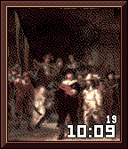
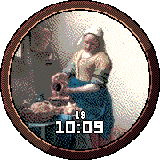
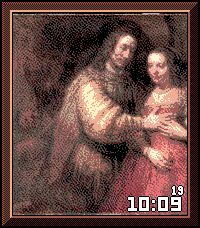
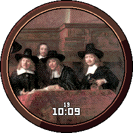

# NightWatch

NightWatch brings centuries of fine art to your Pebble watch. Powered by the
Rijksmuseum's open-data collection.

Every day it hangs a different public-domain painting on your wrist, cropped
for your watch's exact screen, with a small time and date that stay out of
its way.

**[Get it on the Rebble appstore](https://apps.repebble.com/d89b36f0b3e247d580863764)**

| Pebble Time | Pebble Time Round | Pebble Time 2 | Pebble Round 2 |
|:---:|:---:|:---:|:---:|
|  |  |  |  |

## Features

- **A new painting every day**, weekly or monthly, from the 365 Featured
  paintings (the Rijksmuseum works most read about on Wikipedia) or a random
  Selection, optionally from one era. Only public-domain and openly licensed
  works.
- **Made for your screen**: 144×168, 180×180 round, 200×228 or 260×260 round,
  on the color Pebbles (Time, Time Steel, Time Round, Time 2, Round 2; see
  [Supported watches](docs/DEVICES.md)).
- **Smart crop** that finds faces, detail and color and keeps a portrait's
  head in view, or *Contain* to see the whole painting. Zoom in up to 200 % and
  move the view; it's remembered per painting.
- **Frames**: wood, gold, a gallery mat or none.
- **Colors made for the Pebble screen**: dithered to its 64 colors, with tuning
  for daylight, indoor or backlit viewing, plus brightness and contrast.
- **Date and time** in the Pebble's LECO font: 12/24h, several date formats,
  three sizes, nine positions, an optional dark box for readability.
- **Auto hide**: the painting stays clean until you flick your wrist.
- **Pin a painting** you love: search by title or artist, or paste an object
  number or link.
- **A live preview** on the settings page that shows exactly what the watch
  will show, a zoomable full-resolution view of the painting, a short tour,
  and backup and restore. In English and Dutch.

All settings and their defaults: [docs/SETTINGS.md](docs/SETTINGS.md).

## How it works

There is no server. A **generator** does the slow work once, ahead of time,
and writes a catalog of small JSON files. The catalog is published next to the
settings page as static files. The **phone** loads the catalog file it needs,
asks the Rijksmuseum's IIIF image server for the planned crop at the screen's
exact size, adjusts the colors, adds the frame and streams the pixels to the
**watch**.

```
┌──────────────┐  once a day   ┌──────────────────┐  crop (PNG)   ┌──────────────────┐
│ Pebble       │ ◀── bitmap ── │ Phone (PebbleKit │ ◀──────────── │ Rijksmuseum IIIF │
│ watchface C  │ ─ screen info▶│ JS)              │               │ image server     │
└──────────────┘               └──────────────────┘  ┌─ picture ─ │ (iiif.micr.io)   │
                                         ▲           ▼            └──────────────────┘
                                         │    settings page (static files in site/)
                                         │           ▲
                       catalog/web/ ─────┴───────────┘  (copied into site/catalog/)
                                ▲
                   ┌────────────┴─────┐  when you want a fresh catalog, ~1 request/s
                   │ generator (Rust) │ ◀── data.rijksmuseum.nl, iiif.micr.io, wikidata.org
                   └──────────────────┘
```

| Path | What it is |
|---|---|
| `generator/` | Rust: fetches paintings, checks licenses, ranks Featured, plans a smart crop per screen, writes `catalog/web/` |
| `watchface/` | The Pebble project: the C watchface (`src/c/main.c`) and the phone-side JS (`src/pkjs/`) |
| `site/` | The settings page (plain HTML/CSS/JS), plus the JS shared with the phone (`catalog.js`, `render.js`, `settings.js`, `looks.js`) |
| `scripts/` | Build and helper scripts: `bundle-catalog.mjs`, `build-site.mjs`, `catalog.sh`, `emulator-images.mjs`, `device-mockups.py` |
| `docs/` | The details, see below |

The full design is in [docs/ARCHITECTURE.md](docs/ARCHITECTURE.md).

## 1. How the generator works

The generator (`generator/`, binary `nightwatch-generator`) builds the
painting catalog. It:

1. crawls the Rijksmuseum's Search API for paintings with an image, and again
   per century for the era filter;
2. resolves each painting's Linked Art record and keeps only works marked
   public domain, CC0, CC BY or CC BY-SA;
3. downloads one 1200 px master image per painting, for planning only;
4. ranks the Featured 365 by Wikipedia page views (all languages, last 12
   months), only when that list is missing or you ask for a refresh;
5. plans a Cover crop of every painting for each of the four screens, with a
   smart crop for paintings that don't almost fit;
6. writes `catalog/web/`: a manifest, the Featured list, one file per era and
   a search index (~1.75 MB together).

It is polite (one request per second by default, backing off on errors), safe
to stop at any time, and only redoes what changed. Run it whenever you want a
fresh catalog, for example to pick up paintings the Rijksmuseum added:

```sh
cp .env.example .env                                               # set CONTACT
scripts/catalog.sh fetch                                           # optional: reuse the shared Featured list
docker compose run --rm generator nightwatch-generator --limit 20  # quick test run
docker compose run --rm generator                                  # everything (the first run takes hours)
```

Options, timings and the release artifact: [docs/GENERATOR.md](docs/GENERATOR.md).

## 2. How the app is built

The watchface is a standard Pebble project built with the
[Pebble SDK](https://developer.repebble.com) (4.33). The catalog isn't part of
the app: the phone loads it from the settings page's host, so a new catalog
never needs a new `.pbw`.

The phone-side JS gets its settings from one of two files in
`watchface/src/pkjs/`, picked at build time:

| File | In git | Used by | Holds |
|---|---|---|---|
| `config.production.js` | yes | `npm run build:watch` | `SETTINGS_URL`, where the settings page and catalog live |
| `config.dev.js` | no | a plain `pebble build`, when the file exists | your local `SETTINGS_URL`, plus `DEV_BASE64_URL` and `DEBUG` for testing |

```sh
npm run build:watch                     # release build → watchface/build/watchface.pbw
cd watchface
pebble install --phone <phone-ip>       # or --emulator basalt|chalk|emery|gabbro
```

Always upload a build made with `npm run build:watch`, and bump `version` in
`watchface/package.json` for each upload. For local testing (dev server,
emulator, debug pane) see
[docs/DEPLOY.md](docs/DEPLOY.md#testing-locally).

## 3. How to deploy your own instance

You need the Pebble SDK, Node 20.19+ and Docker (or Rust) for the generator.

1. **Generate the catalog** (step 1 above).
2. **Build and publish the site.** `npm run build:site` copies the catalog
   into the site and writes a minified copy to `dist/`. Publish `dist/` on any
   static host over HTTPS. For Cloudflare, `npm run deploy` builds and uploads
   it with wrangler (the Worker name is in `wrangler.jsonc`).
3. **Point the watchface at it.** Set `SETTINGS_URL` in
   `watchface/src/pkjs/config.production.js` to your site (no trailing slash).
4. **Make it your own app.** Give it its own `uuid` and `displayName` in
   `watchface/package.json`, so it doesn't collide with NightWatch.
5. **Build and install** with `npm run build:watch` (step 2 above), then open
   the watchface's settings in the Pebble app.

When you rerun the generator later, only step 2 is needed: the phone notices
the new catalog the next time it picks a painting. Step by step, with
Cloudflare and custom domains: [docs/DEPLOY.md](docs/DEPLOY.md).

## Development

```sh
npm install
npm run lint                     # ESLint for all JS
npm test                         # render.js, catalog.js, settings and looks (watchface/test/)
cd generator && cargo test       # crop planning, license rules, catalog
npm run dev                      # settings page on :8090, emulator image helper on :8092
```

| Doc | What's in it |
|---|---|
| [ARCHITECTURE.md](docs/ARCHITECTURE.md) | How the pieces fit: the daily flow, catalog format, crops, rendering, message keys |
| [GENERATOR.md](docs/GENERATOR.md) | Running the generator, its options, what it redoes and how long it takes |
| [DEPLOY.md](docs/DEPLOY.md) | Building, publishing and testing locally |
| [SETTINGS.md](docs/SETTINGS.md) | Every setting and its default, gestures |
| [DEVICES.md](docs/DEVICES.md) | Supported watches and their screens |

## Contributing

Contributions and feature requests are welcome.
[Open an issue](https://github.com/jesse-mm/nightwatch/issues/new) to report a
bug, suggest a painting crop that went wrong, or propose a feature, or browse
the [open issues](https://github.com/jesse-mm/nightwatch/issues).
[Pull requests](https://github.com/jesse-mm/nightwatch/pulls) are welcome too.
For larger changes, open an issue first so we can talk it through. Please run `npm run lint` and `npm test` (and `cargo test` for the
generator) before sending a pull request.

## License and credits

The code is [MIT](LICENSE) licensed.

Paintings, images and metadata come from the Rijksmuseum, Amsterdam, via the
[Rijksmuseum data services](https://data.rijksmuseum.nl/about/). NightWatch is
an independent project, not affiliated with or endorsed by the Rijksmuseum. If
you enjoy the paintings, consider
[supporting the museum](https://www.rijksmuseum.nl/en/support/donate).

The color approach is based on
[pebble-color-optimizer](https://github.com/czmanix/pebble-color-optimizer)
(MIT). The Featured list is ranked with Wikidata and Wikipedia page views.

The paintings, fonts and vendored libraries keep their own
licenses: see [NOTICE.md](NOTICE.md) for the full credits.
