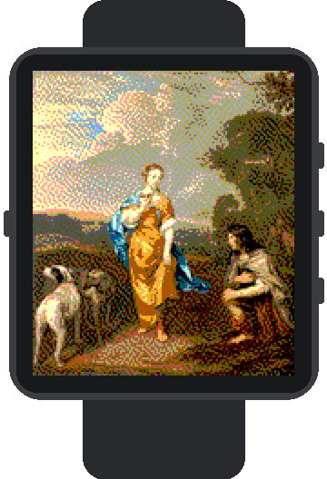
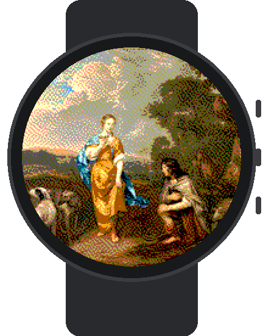
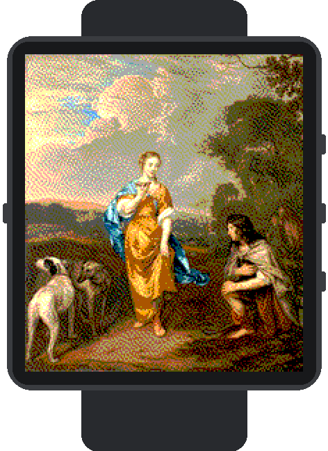
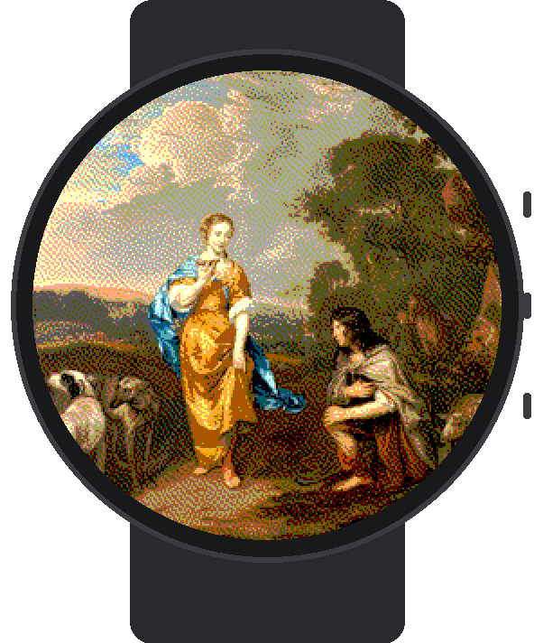
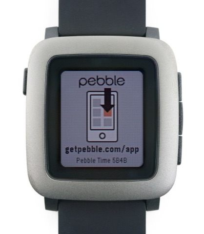
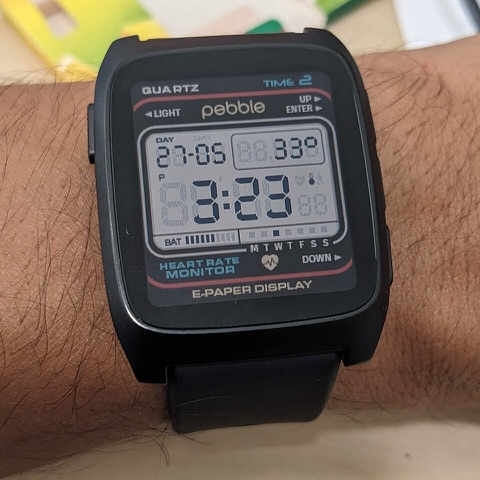

# Supported watches

Treasure Trove supports the **colour** Pebbles. The generator cuts every
painting for each of their four screens, so the crop names in `data/art/<key>/c/`
map to watches like this:

| Screen | Shape | Platform | Watches | Crops |
|---|---|---|---|---|
| 144 × 168 | rectangle | `basalt` | Pebble Time, Pebble Time Steel | `144x168-rect-fill.png`, `-whole.png` |
| 180 × 180 | round | `chalk` | Pebble Time Round | `180x180-round-fill.png`, `-whole.png` |
| 200 × 228 | rectangle | `emery` | Pebble Time 2 | `200x228-rect-fill.png`, `-whole.png` |
| 260 × 260 | round | `gabbro` | Pebble Round 2 | `260x260-round-fill.png`, `-whole.png` |

All four have 64-colour e-paper displays. The black-and-white Pebbles (`aplite`:
Pebble and Pebble Steel; `diorite`: Pebble 2; `flint`: Pebble 2 Duo) aren't
supported for now. Platform names and resolutions come from the Pebble SDK
(`pebble_sdk_platform.py`) and the
[hardware overview](https://developer.repebble.com/guides/tools-and-resources/hardware-information/).

## What each screen shows

The same painting on each screen, straight from the generator's output
(*Accurate* colours, no frame, filling the screen), drawn at 2× with every
watch pixel visible. The watches are drawn to scale with each other.

| Pebble Time / Time Steel | Pebble Time Round | Pebble Time 2 | Pebble Round 2 |
|:---:|:---:|:---:|:---:|
|  |  |  |  |
| 144 × 168, `basalt` | 180 × 180, `chalk` | 200 × 228, `emery` | 260 × 260, `gabbro` |

*The Meeting of Granida and Daifilo*, Jan Mijtens, c. 1655–1660,
[SK-A-1856](https://www.rijksmuseum.nl/en/collection/SK-A-1856), Rijksmuseum,
Amsterdam (public domain). The mockups are drawn by
[`scripts/device-mockups.py`](../scripts/device-mockups.py); regenerate them with

```sh
python3 scripts/device-mockups.py data 200107756 docs/images/devices
```

## The real watches

| Pebble Time | Pebble Time 2 |
|:---:|:---:|
|  |  |
| Photo: [Frmorrison](https://commons.wikimedia.org/wiki/File:Pebble_Time_front.jpg), [CC BY-SA 3.0](https://creativecommons.org/licenses/by-sa/3.0/), resized | Photo: [Waldyrious](https://commons.wikimedia.org/wiki/File:Pebble_Time_2_%2B_Quartz_watchface_(close-up).jpg), [CC BY-SA 4.0](https://creativecommons.org/licenses/by-sa/4.0/), resized |

The Pebble Time Steel has the same screen as the Pebble Time. There are no
freely licensed photos of the front of the Pebble Time Round or the Pebble
Round 2 on Wikimedia Commons yet, so those two are only shown as mockups above.
